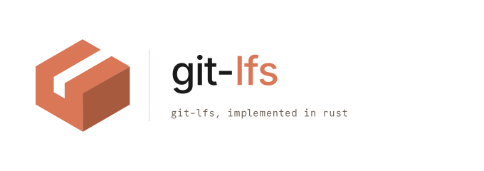

<picture>
  <source media="(prefers-color-scheme: dark)" srcset="docs/branding/banner-dark.svg">
  
</picture>

# Git Large File Storage

A from-scratch Rust port of [Git LFS](https://github.com/git-lfs/git-lfs).  The
goal is feature parity with the upstream Go binary at the CLI and protocol
level, with better help output and a clean split into libraries.

## Status

It targets [Git LFS v3.8.1](https://github.com/git-lfs/git-lfs/tree/v3.8.1),
whose specs and shell tests are included here.

Work in progress, but most of upstream's functionality is implemented and works
end to end. All of upstream's tests pass except one that checks the help
output, which differs on purpose (see the [scoreboard](tests/SCOREBOARD.md)).

## Why

To be completely honest, the reason I started this was that I didn't like how
the help output of `git-lfs` looks, and I felt I could do better. Naturally,
instead of opening a pull request, I started reimplementing the whole thing, as
one does. And now that I've started, quitting isn't an option. So Rust is
gaining a native git-lfs.

Jokes aside, implementing git-lfs has been quite a learning exercise.  It's
more complex than I would have imagined, but it's also well-scoped, and the
upstream test suite is genuinely good. The aim is reasonably clean Rust code
that can serve as a basis for future experimentation.

Down the line that could mean using gitoxide, or adding Git LFS extensions such
as content-defined chunking, which uploads less data when large files change.

## Installing

**Homebrew** (Linux and macOS):

    brew tap rustutils/tap
    brew install rustutils/tap/git-lfs

**APT** (Debian and Ubuntu):

    sudo install -d -m 0755 /etc/apt/keyrings
    sudo curl -fsSLo /etc/apt/keyrings/rustutils.asc https://rustutils.gitlab.io/apt/rustutils.asc
    echo "deb [signed-by=/etc/apt/keyrings/rustutils.asc] https://rustutils.gitlab.io/apt stable main" \
      | sudo tee /etc/apt/sources.list.d/rustutils.list
    sudo apt update
    sudo apt install git-lfs-rs

**RPM** (Fedora, RHEL, Rocky, AlmaLinux):

    sudo curl -fsSLo /etc/yum.repos.d/rustutils.repo https://rustutils.gitlab.io/rpm/rustutils.repo
    sudo dnf install git-lfs-rs

**Cargo** (any platform with a Rust toolchain):

    cargo install git-lfs

After installing, run `git lfs install` once per machine to register the clean,
smudge, and process filters in your global git config. See
[docs/install.md](docs/install.md) for more details.

## Building and testing

Build with cargo:

    cargo build --release

There are two sets of tests. The Rust tests run with cargo:

    cargo test

The repository also includes upstream's shell test suite, which needs Go,
`prove`, and Perl (see the [tests README](tests/README.md) for setup). This
runs it and prints a summary per suite:

    cargo xtask test

## License

MIT, with attribution to the upstream Git LFS contributors. See
[LICENSE.md](LICENSE.md).
